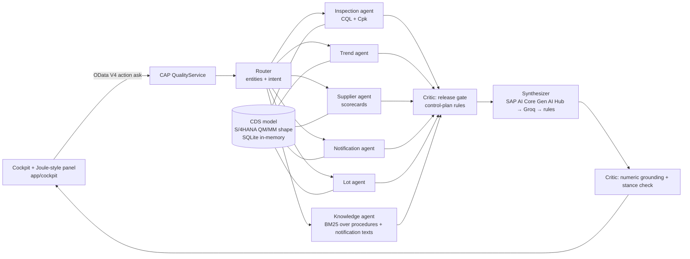

# Quality Copilot: SAP CAP + Generative AI Hub agentic RAG

**Live demo:** https://quality.138.2.179.154.sslip.io

A Joule-style quality assistant built as an **SAP Cloud Application Programming Model (CAP)** service.
It answers supplier-quality questions over **S/4HANA-shaped QM and MM data** (inspection lots,
usage decisions, Q1/Q2/Q3 notifications, purchase orders) and plant procedures. Each answer is
backed by data, cites its sources, and passes a critic before it is shown.

Questions it handles:

- "Can we release AX-4CR13-080 from V200 now?" → release gate from the control plan, with reasons and warnings
- "Why did HV10 drift in July and August?" → trend, Q-notifications and the heat-treatment work instruction
- "Which supplier is worst and why?" → supplier scorecards (lot reject rate, defect PPM, rating)
- "Is the porosity problem at AluGuss solved?" → recurrence check plus last-30-days Cpk
- "Show lot 010000004061" / "Tell me about 200001012" → record lookup

## Architecture



| Layer | SAP building block | In this repo |
|---|---|---|
| Data model | CDS entities | `db/schema.cds` covers plants, suppliers, materials, specifications, purchase orders, inspection lots, results, quality notifications |
| Service | CAP OData V4, actions and functions | `srv/quality-service.cds`: read-only projections, plus `ask`, `cockpit()`, `scorecards()`, `providerInfo()` |
| Agent | CAP service handlers + CQL | `srv/agent/`: router, tools, retriever, critic, LLM chain, orchestrator |
| LLM | SAP AI Core, Generative AI Hub (orchestration) | `@sap-ai-sdk/orchestration`; used when an `aicore` binding or `AICORE_SERVICE_KEY` exists |
| UI | Fiori elements preview + custom Horizon-style page | `app/annotations.cds`, `app/cockpit/index.html` |
| Deploy | MTA on BTP Cloud Foundry | `mta.yaml`, `mta-aicore.mtaext` |

### How the agent answers

1. **Router** (rules, so the plan is predictable) reads the question. It extracts suppliers (V100 to V400 or names), materials, characteristics (HV10, BEND_F, DIAM, POROSITY and more), notification, lot and batch IDs, and the intent: release, trend, root cause, solved, scorecard.
2. **Specialist tools** run CQL against the CDS model in parallel. Cpk uses \(\sigma_{total} = \sqrt{\overline{s^2_{within}} + s^2_{between}}\) over lot results, for all time and for the last 30 days. A lower limit of 0 (porosity) is treated as a natural bound, so only Cpu applies there.
3. The **knowledge agent** runs BM25 over the plant procedures in `knowledge/` and the notification long texts. At index time it drops any text that looks like a prompt injection.
4. The **critic release gate** applies the control-plan rule: usage decision A, no open Q-notification, and Cpk ≥ 1.33 over the last 30 days. The decision comes from code, never from the LLM.
5. The **synthesizer** writes the answer from facts only. The provider chain is SAP AI Core Generative AI Hub, then Groq (two models), then a deterministic composer. The UI shows which one answered.
6. The **critic grounding check** rejects the LLM answer and uses the rule-based draft when:
   - a number in the answer is not in the retrieved facts, or
   - the conclusion contradicts the rule decision (for example "not solved" when the data shows no recurrence).
7. A prompt-injection filter on the question blocks requests to ignore instructions or reveal keys.

## Demo data

The data is fictional, deterministic, and generated by `scripts/generate-data.js`: 136 goods-receipt lots (origin 01), February to September 2026, at plant DE10. It contains a story to investigate:

- **V200 Härterei Weser** (heat treater for the 4Cr13 8.0 mm axle). Between 6 July and 21 August the tempering furnace thermocouple drifted, so parts were under-tempered: HV10 rose above 650 and bending force dropped. Six lots were rejected. One batch passed goods-receipt sampling and caused a **Q1 customer complaint** (brittle fracture, cleavage facets). The 8D replaced the thermocouple, and lots after 24 August are back in spec.
- **V300 AluGuss Süd** had a porosity spike in May (a die thermal unit failure). It has been solved since then, but an open packaging Q2 still blocks release.
- **V100 Nordstahl** had one chemistry mix-up in March. **V400 Lippe** is the good supplier (rating A).

The procedures in `knowledge/` were written for this demo. They reference test methods by name only and contain no copied standard text.

## Run locally

```bash
npm ci
npm run watch          # or: npm start   ->  http://localhost:4004
npm test               # 19 tests (router, critic, retriever, OData service, ask action)
```

To have an LLM write the answers, set `GROQ_API_KEY`, or set `AICORE_SERVICE_KEY` (the JSON service key of an SAP AI Core instance) to use the Generative AI Hub. Without a key, the deterministic composer answers from the same facts.

## Deploy to SAP BTP (Cloud Foundry)

```bash
npm i -g mbt && brew install cloudfoundry/tap/cf-cli@8
cf login -a https://api.cf.<region>.hana.ondemand.com --sso
mbt build && cf deploy mta_archives/sap-btp-quality-copilot_1.0.0.mtar
cf set-env quality-copilot-srv GROQ_API_KEY <key> && cf restage quality-copilot-srv   # optional
```

To use the Generative AI Hub on an account with the AI Core **extended** plan, run
`cf deploy mta_archives/*.mtar -e mta-aicore.mtaext`. This activates the `aicore` service binding, and the SAP AI SDK picks it up automatically.

The live demo above runs the same container on a single-node k3s cluster (`Dockerfile`, `deploy/k8s.yaml`).

## Scope and next steps

- The **BTP trial does not include SAP AI Core**, so the public demo uses Groq. The Generative AI Hub code path is implemented and switches on with an AI Core binding or key.
- The data is S/4HANA-*shaped* CSV, not a live S/4HANA connection. Next step: consume the released OData APIs (`API_INSPECTIONLOT_SRV`, `API_QUALITYNOTIFICATION`) through a BTP destination.
- Retrieval is BM25 in memory. Next step: SAP HANA Cloud vector engine with Gen AI Hub embeddings.
- The demo is public and read-only. For production: XSUAA with `@requires` roles, plus an approuter.
- `npm audit` reports `node-forge` (high) through transitive SAP Cloud SDK dependencies, with no non-breaking fix yet. It is tracked for an upstream fix.

## Licence

MIT. All companies, people, lots and notifications are fictional.
